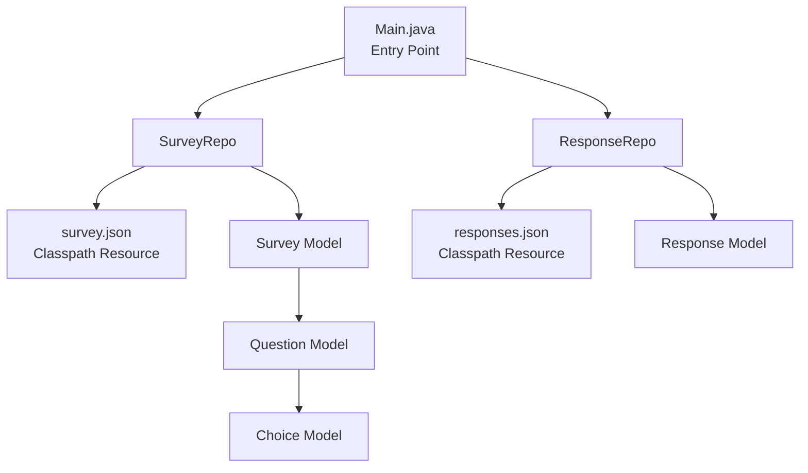
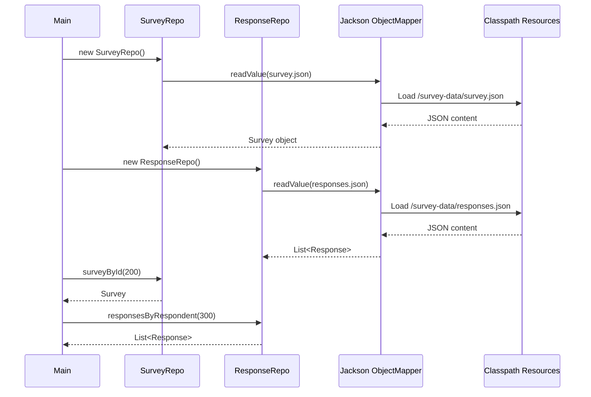
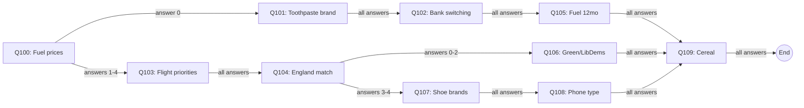
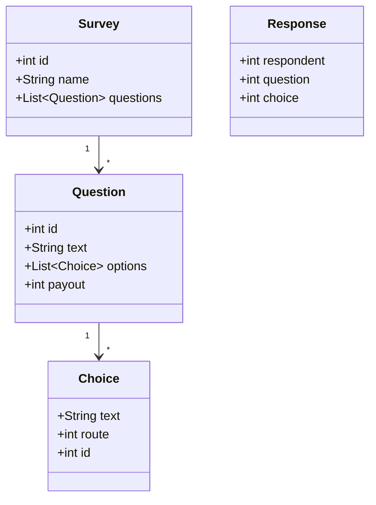

# Architecture

## Overview

This is a Java 17 console application used as a backend engineering interview take-home scenario at Attest. It models a **survey system** where respondents answer routed questions and earn payouts. The application loads survey definitions and response data from static JSON files and provides repository classes for querying them.

## High-Level Component Diagram



## Package Structure

```
com.askattest.interview
├── Main.java                  # Application entry point
├── models/
│   ├── Survey.java            # Survey entity (id, name, questions)
│   ├── Question.java          # Question entity (id, text, options, payout)
│   ├── Choice.java            # Answer choice (text, route, id)
│   └── Response.java          # Respondent answer (respondent, question, choice)
└── repository/
    ├── SurveyRepo.java        # Loads & queries survey data
    └── ResponseRepo.java      # Loads & queries response data
```

## Data Flow



## Survey Routing Model

The survey uses a **routed/branching** question flow. Each answer choice has an optional `route` field pointing to the next question ID. When `route` is absent (or `-1` in the Java model), the survey ends.



## Domain Model



## Build Systems

The project supports **two** build systems (candidate may choose either):

| Tool   | Config File     | Run Command                      |
|--------|-----------------|----------------------------------|
| Gradle | `build.gradle`  | `./gradlew clean build run`      |
| Maven  | `pom.xml`       | `mvn clean package exec:java`    |

## Key Dependencies

| Dependency         | Version  | Purpose                  |
|--------------------|----------|--------------------------|
| Jackson Databind   | 2.17.1   | JSON deserialisation     |
| JUnit 5 (Jupiter)  | 5.10.0   | Testing framework        |
| Shadow Plugin      | 8.3.3    | Fat JAR packaging (Gradle) |

## Design Decisions & Notes

- **No framework**: Deliberately kept framework-free (no Spring, Micronaut, etc.) to keep the interview focused on core Java skills.
- **Public fields on models**: POJOs use public fields rather than getters/setters for brevity. Jackson handles this via field-level access.
- **In-memory data**: All data is loaded into memory at startup from classpath JSON files. There is no database.
- **`Choice.route = -1`**: Sentinel value indicating the survey terminates after that choice.
